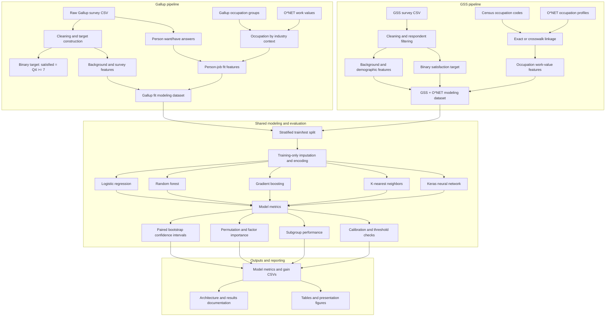

# Modeling Pipeline Architecture

The project maintains parallel Gallup and GSS survey pipelines. Both target
job satisfaction, but each uses its own source schema and occupation linkage.
The Gallup pipeline is implemented and runnable; the GSS pipeline is partially
implemented and will converge on the shared model-evaluation interface.

## Gallup modeling stages

1. Clean the raw Gallup survey and build the `satisfied` target.
2. Link occupation and industry context to O*NET or occupation-level averages.
3. Engineer fit features by comparing wants with delivered job characteristics.
4. Build increasingly rich feature tiers:
   - Tier A: background factors
   - Tier B: profile and job facts
   - Tier C: want/have answers and fit scores
   - Tier D: job conditions
   - Tier E: personal job appraisals
   - Tier F: well-being leakage ceiling, excluded from usable results
5. Train, tune, and evaluate models on the same held-out test set.
6. Calculate bootstrap improvements, permutation importance, weighted metrics,
   and subgroup results.

## GSS modeling stages

1. Clean and filter the GSS respondent file.
2. Normalize Census occupation codes.
3. Link occupations to O*NET profiles through documented Census/O*NET
   crosswalks.
4. Merge respondent satisfaction, background factors, and occupation
   characteristics.
5. Build a Gallup-comparable person-job fit feature set where survey questions
   support the comparison.
6. Run the shared train/test, metric, bootstrap, and reporting workflow.

## Leakage boundaries

- The target and second-job satisfaction must never be model features.
- Tier F well-being features are a leakage ceiling and are never used for
  deployable models.
- Hyperparameters and F1 thresholds must come only from training data.
- Job-level averages use out-of-fold training means and training-only test
  means.
- Test respondents must not affect preprocessing, tuning, feature generation,
  or threshold selection.

## Remaining validation work

- Occupation, industry, and occupation-industry held-out validation is implemented.
- Add survey-year-held-out validation.
- Add raw-data manifests and source checksums.
- Add a shared command-line entry point for Gallup and GSS pipelines.
- Add calibration plots, subgroup confidence intervals, and model cards.
